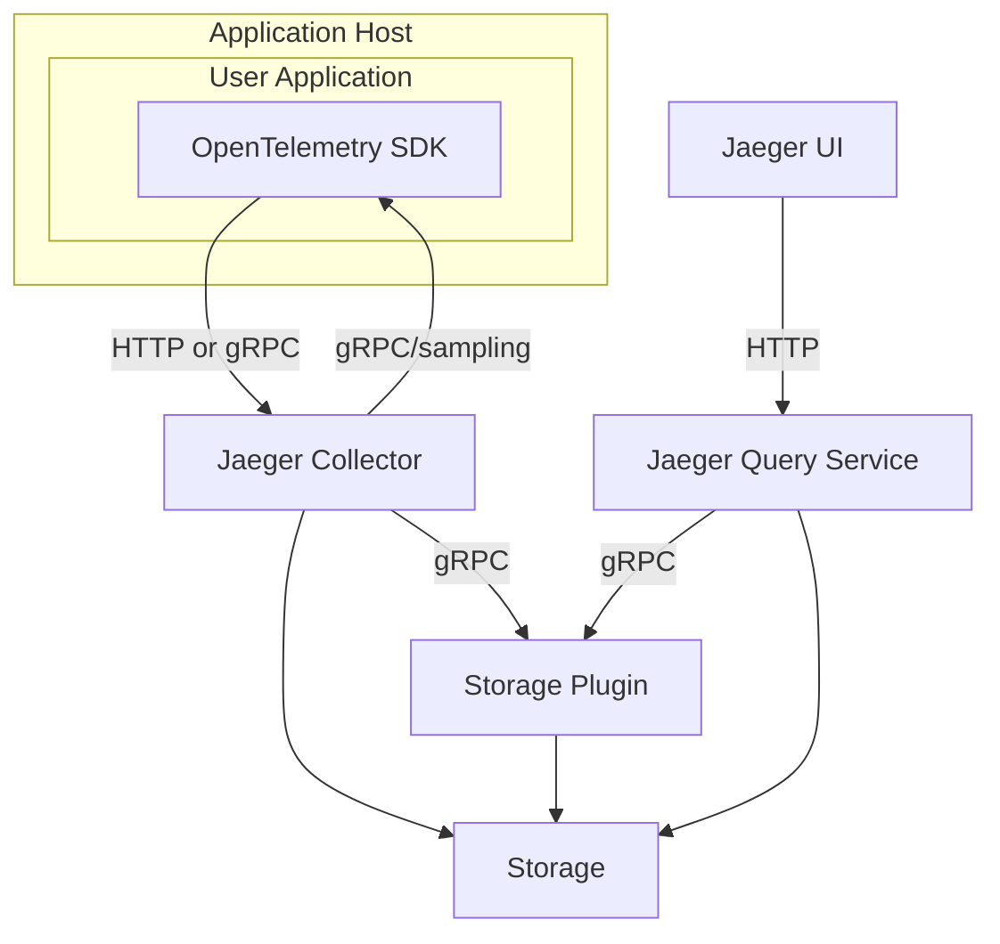

[English](https://github.com/jaegertracing/jaeger/blob/main/README.md) | 简体中文

[](https://stand-with-ukraine.pp.ua)


[![Slack chat][slack-img]](#联系我们)
[![Unit Tests][ci-img]][ci]
[![Coverage Status][cov-img]][cov]
[![Project+Community stats][community-badge]][community-stats]
[![FOSSA Status][fossa-img]][fossa]
[![OpenSSF Scorecard][openssf-img]][openssf]
[![OpenSSF Best Practices][openssf-bp-img]][openssf-bp]
[![CLOMonitor][clomonitor-img]][clomonitor]
[![Artifact Hub][artifacthub-img]][artifacthub]


# Jaeger —— 分布式追踪系统

💥💥💥 Jaeger v2 已经发布！阅读[博客文章](https://medium.com/jaegertracing/jaeger-v2-released-09a6033d1b10)，或者[上手试试](https://www.jaegertracing.io/docs/latest/getting-started/)。

## 快速开始

用 Docker 几秒钟就能把 Jaeger 跑起来：

```bash
# 运行 Jaeger all-in-one（包含 UI、collector、query 和内存存储）
docker run --rm --name jaeger \
  -p 16686:16686 \
  -p 4317:4317 \
  -p 4318:4318 \
  jaegertracing/jaeger:latest

# 访问 UI：http://localhost:16686
# 通过 OTLP 发送追踪数据：gRPC 走 4317 端口，HTTP 走 4318 端口
```

如需生产环境部署方案和更多选项，请见[入门指南](https://www.jaegertracing.io/docs/latest/getting-started/)。

## 架构



Jaeger 是一个分布式追踪平台，由 [Uber Technologies](https://eng.uber.com/distributed-tracing/) 创建，并捐赠给[云原生计算基金会](https://cncf.io)。

入门、运维细节以及其他信息，请见 Jaeger [文档][doc]。

Jaeger 由[云原生计算基金会](https://cncf.io)（CNCF）托管，是第 7 个顶级项目，于 2019 年 10 月毕业。参见 CNCF 的 [Jaeger 孵化公告](https://www.cncf.io/blog/2017/09/13/cncf-hosts-jaeger/)和 [Jaeger 毕业公告](https://www.cncf.io/announcement/2019/10/31/cloud-native-computing-foundation-announces-jaeger-graduation/)。

## 参与社区

Jaeger 是一个采用开放治理的开源项目。我们欢迎社区贡献，也非常希望你能帮助改进和扩展这个项目。这里有一些[参与方式](https://www.jaegertracing.io/get-involved/)，其中不少甚至不需要写代码。

## 版本兼容性保证

由于 Jaeger 使用了大量来自 [OpenTelemetry Collector](https://github.com/open-telemetry/opentelemetry-collector/) 的组件，我们会尽量保持各个 Jaeger 版本之间的配置兼容性。出于易用性改进、新增功能或依赖变更，Jaeger 中的配置项（以及 Jaeger v1 的命令行参数）偶尔会被弃用。
遇到这种情况，引入弃用的开发者必须遵循[这些指引](./CONTRIBUTING.md#deprecating-cli-flags)。

简而言之，对于已弃用的配置项，你应该会在文档或发布说明中看到这样的提示：
```
(deprecated, will be removed after yyyy-mm-dd or in release vX.Y.Z, whichever is later)
```

从包含该弃用提示的第一个版本算起，至少会提供 **3 个月**或**两个小版本**的宽限期（以较晚者为准），之后这个已弃用的配置项_才可以_被删除。

举例来说，假设 v2.0.0 于 2024-09-01 发布，其中包含某个配置项的弃用提示。
该配置项会一直保持弃用状态，直到 2024-12-01 或 v2.2.0 中较晚的那个时间点，此后_才可以_将其移除。
它也可能在超过上述宽限期后仍保持弃用状态。

## Go 版本兼容性保证

Jaeger 项目会尽量跟随 Go 团队[定义](https://go.dev/doc/devel/release#policy)的当前受支持 Go 版本。
移除对不再受支持的 Go 版本的支持，不视为破坏性变更。

从 Go 1.21 发布开始，Go 版本支持将按以下方式更新：

1. 新的 Go 小版本 `N` 发布后不久，构建和测试步骤就会更新以适配最新的 Go 小版本。
2. 新的 Go 小版本 `N` 发布后不久，对 Go 版本 `N-1` 的支持将被移除，版本 `N` 成为最低要求版本。

注意：所有可导入的代码都已移入 internal 包，因此不再需要兼容旧版编译器（此前使用的是 `N-1` 版本）。

## 存储后端版本支持策略

本策略只覆盖那些对项目而言仍适合测试、维护并推荐用于生产环境的存储后端版本。策略覆盖范围与“技术上仍可能兼容 Jaeger 的版本”是两回事。

对于有公开上游生命周期的后端，Jaeger 以该后端项目或厂商的支持版本策略、停止支持（EOL）策略为依据，具体覆盖范围见下文。一旦上游支持结束，Jaeger 可能会移除 CI 覆盖、不再主动修复该版本的后端特有问题，并要求用户先升级再排查问题。

对于没有明确上游生命周期的后端，Jaeger 支持当前稳定大版本及其前一个大版本。更早的版本仅尽力支持，当它们阻碍开发、安全修复、依赖更新或 CI 稳定性时可能被移除。

各后端的策略如下：

* Elasticsearch：遵循 Elastic 的[产品与版本停止支持策略](https://www.elastic.co/support/eol)。
* OpenSearch：遵循 OpenSearch 的[发布计划与维护策略](https://opensearch.org/releases/)。实际含义是：当前大版本与前一个大版本，且两者都仍在上游维护中。
* Cassandra：遵循 Apache Cassandra 已发布的维护版本线（见 [Cassandra 下载页](https://cassandra.apache.org/_/download.html)），Jaeger 的支持目标是当前大版本与前一个大版本。
* ClickHouse：遵循 ClickHouse 的[发布与回移策略](https://clickhouse.com/docs/development/backports)，以及关于[稳定版与 LTS 版本](https://clickhouse.com/docs/faq/operations/production)的生产环境指引。Jaeger 以 LTS 版本作为支持线，覆盖当前与上一个 LTS 版本——ClickHouse 对 LTS 版本至少同时支持 12 个月。月度稳定版可能仍然兼容，也可能出现在 CI 中，但不在本策略覆盖范围内。

“支持”意味着这些后端版本在主动兼容性修复的范围内。CI 覆盖并不等同于最终的支持矩阵：CI 可能只测试部分受支持版本，也可能尽力保留更早的版本。仅仅出现在 CI 中，并不代表该后端版本受到支持。Jaeger 不为后端产品本身、厂商定制发行版或超出上游维护窗口的版本提供支持。

截至 2026 年 7 月 6 日，本策略的含义如下：

| 后端 | Jaeger 策略依据 | 策略覆盖的版本 | 未覆盖的版本 |
| --- | --- | --- | --- |
| Elasticsearch | Elastic EOL 策略 | `9.x`；`8.19.x` 直至 Elastic 公布的 8.x 维护窗口结束 | `8.18.x` 及更早 |
| OpenSearch | OpenSearch 维护策略 | `3.x`；`2.x`，其中 `2.19.x` 是当前维护的 2.x 版本线 | `1.x` 及更早 |
| Cassandra | 当前大版本加前一个大版本，采用 Apache 维护中的版本线 | `5.0.x`；维护中的 `4.x` 版本线，当前为 `4.1.x` 和 `4.0.x` | `3.x` 及更早 |
| ClickHouse | 当前与上一个 ClickHouse LTS 版本 | `26.3 LTS` 和 `25.8 LTS` | 月度稳定版及更早的 LTS 分支 |

本表仅供参考，应在上游策略或版本线变化时更新。被列为未覆盖的版本仍可能尽力保留在 CI 中；它们出现在 CI 中并不扩展本支持策略。

## 相关仓库

### 组件

 * [UI](https://github.com/jaegertracing/jaeger-ui)
 * [数据模型](https://github.com/jaegertracing/jaeger-idl)

### 文档

  * 已发布：https://www.jaegertracing.io/docs/
  * 源码：https://github.com/jaegertracing/documentation

## 从源码构建

见 [CONTRIBUTING](./CONTRIBUTING.md)。

## 贡献

见 [CONTRIBUTING](./CONTRIBUTING.md)。

感谢所有已经做出贡献的人！

<a href="https://github.com/jaegertracing/jaeger/graphs/contributors">
  
</a>

### 维护者

成为维护者的规则见 [GOVERNANCE](./GOVERNANCE.md)。
Jaeger 项目的官方维护者列在 [MAINTAINERS](./MAINTAINERS.md) 中。
在 issue / PR 中可以使用 `@jaegertracing/jaeger-maintainers` 通知他们。

[jaegertracing](https://github.com/jaegertracing) 组织下的部分仓库另有维护者。

## 项目状态会议

Jaeger 维护者和贡献者会定期通过视频会议沟通。所有人都可以参加，包括最终用户。会议详情见 https://www.jaegertracing.io/get-in-touch/。

## 路线图

见 https://www.jaegertracing.io/docs/roadmap/

## 联系我们

有问题、建议或 bug 报告？可以通过以下渠道联系项目社区：

 * [Slack 聊天室 `#jaeger`][slack]（首次使用需先加入 [CNCF Slack][slack-join]）
 * [`jaeger-tracing` 邮件组](https://groups.google.com/forum/#!forum/jaeger-tracing)
 * GitHub [issue](https://github.com/jaegertracing/jaeger/issues) 与 [discussion](https://github.com/jaegertracing/jaeger/discussions)

## 安全

Jaeger 的第三方安全审计结果见 https://github.com/jaegertracing/security-audits。Jaeger 现有安全机制的概览请见 [Issue #1718](https://github.com/jaegertracing/jaeger/issues/1718)。

## 采用者

Jaeger 作为一个产品由多个组件构成。我们希望支持不同类型的用户——无论只是使用我们的埋点库，还是完整部署端到端的 Jaeger；无论运行于生产环境，还是在开发环境中用它排查问题。

目前使用 Jaeger 的部分组织见 [ADOPTERS.md](./ADOPTERS.md)。
如果想把你的组织加入这个列表，请在我们的[调研 issue](https://github.com/jaegertracing/jaeger/issues/207) 下留言。

## 赞助方

Jaeger 项目在开源上的成功很大程度上归功于云原生计算基金会（CNCF）——我们的主要支持者。我们深深感谢他们至关重要的支持。此外，我们感谢 Uber 发起并捐赠了本项目，也感谢 1Password、Codecov.io、Dosu、GitHub、Google Analytics、Netlify 和 Oracle Cloud Infrastructure 持续提供的软件与基础设施支持。感谢你们的慷慨相助。

## 许可证

Copyright (c) The Jaeger Authors. [Apache 2.0 许可证](./LICENSE)。

[doc]: https://jaegertracing.io/docs/
[ci-img]: https://github.com/jaegertracing/jaeger/actions/workflows/ci-unit-tests.yml/badge.svg?branch=main
[ci]: https://github.com/jaegertracing/jaeger/actions/workflows/ci-unit-tests.yml?query=branch%3Amain
[cov-img]: https://codecov.io/gh/jaegertracing/jaeger/branch/main/graph/badge.svg
[cov]: https://codecov.io/gh/jaegertracing/jaeger/branch/main/
[fossa-img]: https://app.fossa.com/api/projects/git%2Bgithub.com%2Fjaegertracing%2Fjaeger.svg?type=shield
[fossa]: https://app.fossa.io/projects/git%2Bgithub.com%2Fjaegertracing%2Fjaeger?ref=badge_shield
[openssf-img]: https://api.securityscorecards.dev/projects/github.com/jaegertracing/jaeger/badge
[openssf]: https://securityscorecards.dev/viewer/?uri=github.com/jaegertracing/jaeger
[openssf-bp-img]: https://www.bestpractices.dev/projects/1273/badge
[openssf-bp]: https://www.bestpractices.dev/projects/1273
[clomonitor-img]: https://img.shields.io/endpoint?url=https://clomonitor.io/api/projects/cncf/jaeger/badge
[clomonitor]: https://clomonitor.io/projects/cncf/jaeger
[artifacthub-img]: https://img.shields.io/endpoint?url=https://artifacthub.io/badge/repository/jaegertracing
[artifacthub]: https://artifacthub.io/packages/search?repo=jaegertracing


[community-badge]: https://img.shields.io/badge/Project+Community-stats-blue.svg
[community-stats]: https://all.devstats.cncf.io/d/54/project-health?orgId=1&var-repogroup_name=Jaeger
[hotrod-tutorial]: https://medium.com/jaegertracing/take-jaeger-for-a-hotrod-ride-233cf43e46c2
[slack]: https://cloud-native.slack.com/archives/CGG7NFUJ3
[slack-join]: https://slack.cncf.io
[slack-img]: https://img.shields.io/badge/slack-join%20chat%20%E2%86%92-brightgreen?logo=slack
