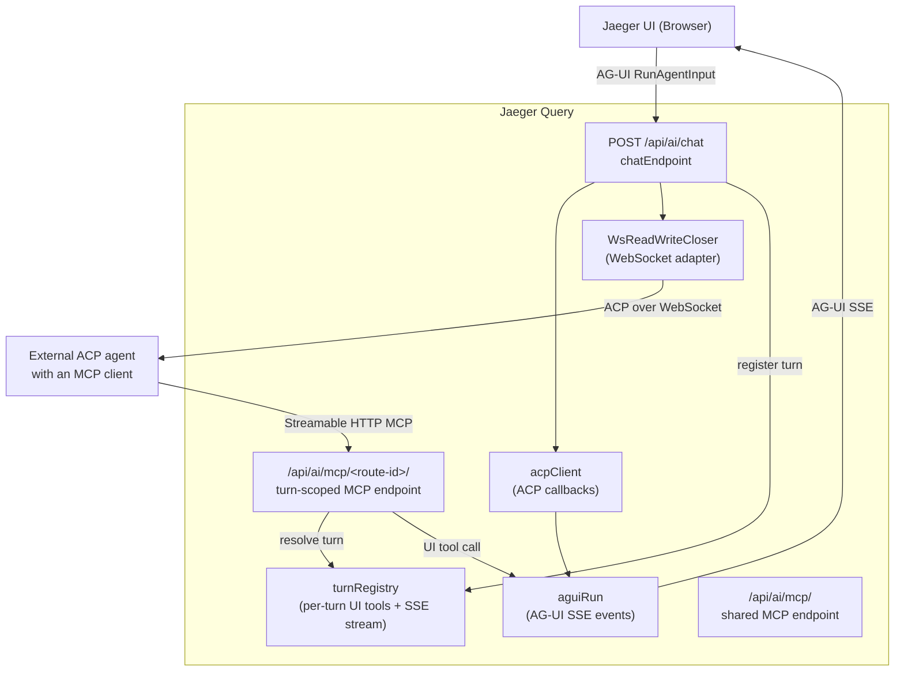
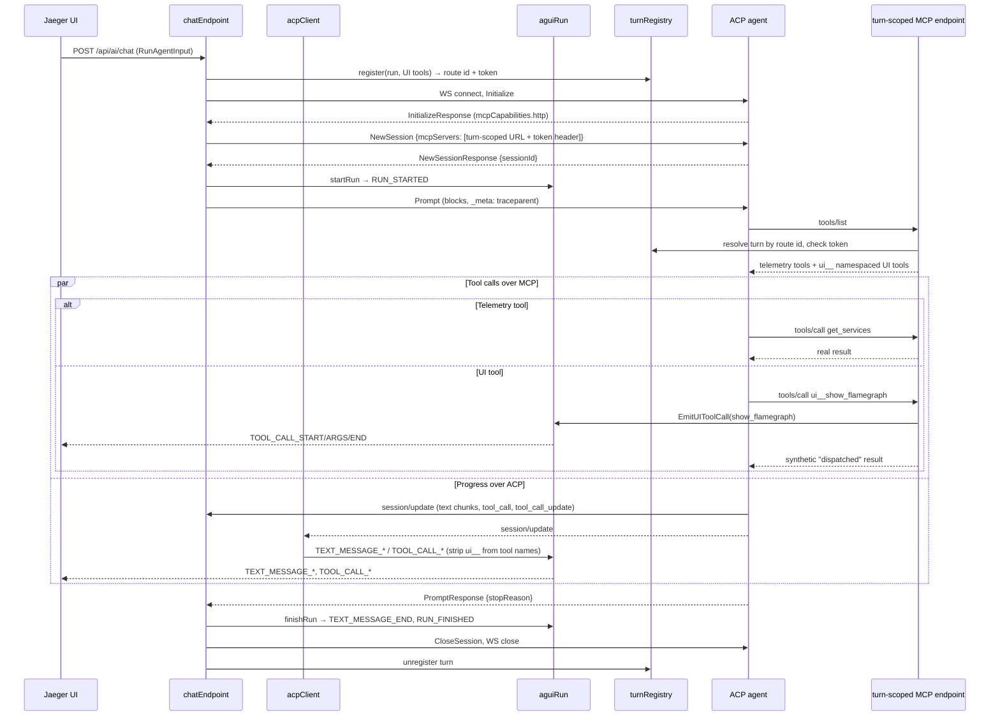

# Jaeger AI Gateway

This package implements the AI gateway in Jaeger Query. It accepts
[AG-UI](https://docs.ag-ui.com/) chat requests from the Jaeger UI, speaks the
[Agent Client Protocol (ACP)](https://agentclientprotocol.com/) to an external
agent, and streams AG-UI Server-Sent Events (SSE) back to the browser.

Agents use Jaeger's turn-scoped [MCP](https://modelcontextprotocol.io/)
endpoint for every tool call. That endpoint serves Jaeger telemetry tools and,
for a chat turn, the UI tools declared by the browser.

## Architecture



The shared endpoint serves the telemetry tools to external MCP clients with no
chat turn involved. The turn-scoped endpoint serves the
same telemetry tools plus the calling turn's UI tools from the same
`mcp.Server`.

## Components

### chatEndpoint (`endpoint_chat.go`)

The chat endpoint is registered at `POST /api/ai/chat` only when
`extensions.jaeger_query.ai.agent_url` is configured. It accepts AG-UI
[`RunAgentInput`](https://docs.ag-ui.com/concepts/run-input) payloads
(`messages`, `tools`, `context`, `threadId`, `runId`), establishes the ACP
WebSocket connection, runs the ACP session lifecycle, and streams AG-UI events
back to the browser. It passes the request's `threadId` and `runId` to the
`aguiRun` so the SSE events match what the AG-UI client expects.

### aguiRun (`agui_run.go`)

`aguiRun` is the server side of one AG-UI run for one chat turn. It writes the
run's events as AG-UI SSE frames into the HTTP response. `acpClient` translates
the agent's output onto it and the turn-scoped MCP endpoint feeds it UI tool calls.

- **Run lifecycle.** `startRun`, `finishRun`, and `failRun` emit `RUN_STARTED`,
  `RUN_FINISHED`, and `RUN_ERROR`. Assistant text is bracketed with
  `TEXT_MESSAGE_START` and `TEXT_MESSAGE_END`; a tool call closes the open
  text message, and text after it starts a new message with a new id.
- **`EmitUIToolCall`.** Called from the MCP endpoint when the agent invokes a UI
  tool. Emits `TOOL_CALL_START`, `TOOL_CALL_ARGS`, and `TOOL_CALL_END` under the
  bare name the browser registered.

A mutex guards its mutable state because `acpClient.SessionUpdate` runs on a
different goroutine than the one driving `Prompt`, while lifecycle calls come from the
chat endpoint and UI tool calls from the MCP endpoint.

### acpClient (`agui_run.go`)

`acpClient` implements the ACP `Client` interface for one chat turn. The ACP
SDK calls it with the agent's notifications and requests, and it drives the
turn's `aguiRun`.

- **`SessionUpdate`.** Maps ACP `session/update` notifications to AG-UI events:
  `AgentMessageChunk` to `TEXT_MESSAGE_CONTENT`; `ToolCall` to
  `TOOL_CALL_START`, plus `TOOL_CALL_ARGS` when `RawInput` is set;
  `ToolCallUpdate` to `TOOL_CALL_ARGS`, `TOOL_CALL_RESULT`, or `TOOL_CALL_END`
  depending on which fields are populated. Thought chunks and plans are
  accepted and dropped. Tool-call notifications are progress display only: the
  tool calls themselves travel over MCP (below), not over ACP. The tool name in
  a notification is the name the agent was offered, so a UI tool arrives with
  `UIToolPrefix`, which is stripped before the event reaches the browser.
- **`RequestPermission`.** Answers `session/request_permission` by selecting the
  first option of kind `allow_once` or `allow_always`, and cancels if the agent
  offers neither. The gateway advertises no filesystem or terminal capability in
  `Initialize`, so a well-behaved agent has nothing else to ask about.
- **Filesystem and terminal operations** return an error, because the gateway
  advertises those capabilities as disabled.

### WsReadWriteCloser (`ws_adapter.go`)

`WsReadWriteCloser` adapts a gorilla WebSocket connection to the
`io.ReadWriteCloser` interface required by the ACP runtime. It presents
discrete WebSocket messages to the SDK as a newline-delimited byte stream and
sends SDK writes as WebSocket text messages.

## Request flow



1. The gateway parses the AG-UI `RunAgentInput`, collecting the latest user
   message and any context entries into ACP prompt blocks. A `tools` entry
   with an empty or whitespace name is rejected with a 400 before any agent
   work happens.
2. It serializes the request's UI-tool declarations and registers them with a
   new turn. The turn registry gives the agent a unique MCP route and holds
   the browser SSE stream for that turn.
3. It creates a standard ACP client connection, runs `Initialize`, then
   `NewSession`. When the agent advertises HTTP MCP support and
   `ai.mcp.base_url` is available, the session announces the turn-scoped MCP
   URL.
4. It emits `RUN_STARTED` and sends `Prompt`, with the request's trace context
   in `_meta` so an agent that propagates it joins its spans to the request's
   trace. While the prompt runs, the agent calls tools over MCP and reports
   progress over ACP; the two legs are concurrent.
5. When the prompt finishes, it closes the ACP session, unregisters the turn,
   and emits `RUN_FINISHED` or `RUN_ERROR`.

## MCP tool routing

The agent calls the announced turn-scoped endpoint using standard MCP
`tools/list` and `tools/call` requests, sending the announced
`X-Jaeger-Turn-Token` header on each. The route id in the URL names the turn
and the token proves the caller was given it: the endpoint is reachable by
anyone who can reach the query port, and a URL ends up in access logs and
traces, so the id alone would not do. Both are random, minted per turn, and
void when the turn ends; a request without the turn's token is refused with
401. The UI-tools middleware in
`mcp_ui_tools.go` layers the turn's UI tools onto the shared telemetry server:

- **Telemetry tools** execute against Jaeger's in-process query service and
  return their results to the agent.
- **UI tools** are the browser-supplied tools attached to the active turn.
  `tools/list` advertises each one as `UIToolPrefix` (`ui__`) plus its frontend
  name. A `tools/call` with that prefix is a UI tool: the gateway strips the
  prefix, confirms the turn declared the tool, emits `TOOL_CALL_*` events over
  the browser's SSE stream under the bare name, and returns a synthetic
  dispatched result immediately. A prefixed name the turn never declared is
  rejected as a tool error, so an agent cannot dispatch a UI tool the frontend
  did not offer. Unprefixed names fall through to the telemetry handlers.

Each tool call runs as the person behind the chat request. The `session/new`
announcement lists, beside the turn token, the identity the query server's
middleware captured from the chat request: the bearer token of
`bearer_token_propagation` and the `header_forwarding` headers under their
inbound names, which are the names the same middleware reads when the tool
request comes back. The agent sends every announced header on every request, so
a tool call reaches the query service as an ordinary request from the caller and
the gateway stores no identity in the turn; the token proves only that a request
belongs to the turn, and a request without the caller's headers runs as nobody.
The MCP handler keeps nothing between requests, so nothing outlives a request
that another request could name. The `ai.auth` authenticator guards the
turn-scoped endpoint as it guards the chat endpoint, and on a tool call it sees
only the announced headers: it admits the call when the credential it reads is
the propagated bearer token or a forwarded header, and refuses the call with
401 when the credential is anything else, a query parameter included. What the
agent holds as a result, and what the deployment has to trust, is on the website's
[AI Assistant page](https://www.jaegertracing.io/docs/latest/ai/assistant/).

The namespace exists so a UI tool can never shadow a telemetry tool of the same
name. The frontend chooses UI tool names per request, so without a namespace
the agent's telemetry capability would depend on what the browser happened to
send. The double underscore follows the convention MCP aggregators use for
sub-domain prefixes, which keeps a coincidental clash with a telemetry tool
name contrived.

UI tools are fire-and-forget by design. They are commands such as
`show_flamegraph(trace_id)` rather than queries, so there is no result to
return to the model. The browser performs the side effect when it sees the
`TOOL_CALL_*` events, and the synthetic result lets the model's loop continue
to a final answer in the same turn. The browser cannot return a value during
the turn; RFC 0008 §4.4 records that as an implementation limit, not a protocol
one.

## Exercising a UI tool without the browser

The website's verification steps send a chat request with no UI tools. To see
the gateway dispatch a UI tool, pass one with the request and ask for it:

```bash
curl -N -X POST http://127.0.0.1:16686/api/ai/chat \
  -H 'Content-Type: application/json' \
  -d '{
    "threadId": "t1", "runId": "r2",
    "messages": [{"role": "user", "content": "show the flamegraph for trace abc123"}],
    "tools": [{
      "name": "show_flamegraph",
      "description": "Open the flamegraph view for a trace_id.",
      "parameters": {"type":"object","properties":{"trace_id":{"type":"string"}},"required":["trace_id"]}
    }]
  }'
```

The stream carries `TOOL_CALL_START`, `TOOL_CALL_ARGS` and `TOOL_CALL_END` for
`show_flamegraph`. The agent sees the tool as `ui__show_flamegraph`, and the
gateway strips the prefix before the event reaches the browser.

The external-agent contract, the Goose worked example, and the operator
configuration are documented on the website, in
[AI Assistant](https://www.jaegertracing.io/docs/latest/ai/assistant/).

## Related code

- `endpoint_chat.go` owns the chat HTTP and ACP lifecycle.
- `endpoint_turn_mcp.go` and `turn_registry.go` provide the per-turn MCP
  route and lifecycle.
- `mcp_ui_tools.go` exposes browser UI tools through MCP under `UIToolPrefix`.
- `agui_run.go` holds `aguiRun` and `acpClient`, which turn the agent's output into AG-UI SSE events.
- `translation.go` holds the AG-UI to ACP helpers, including the prefix strip.
- `ws_adapter.go` adapts the ACP WebSocket transport.
- `../mcptools` serves the shared MCP endpoint and the telemetry tools.

Protocol specifications: [ACP](https://agentclientprotocol.com/) and
[AG-UI](https://docs.ag-ui.com/).
