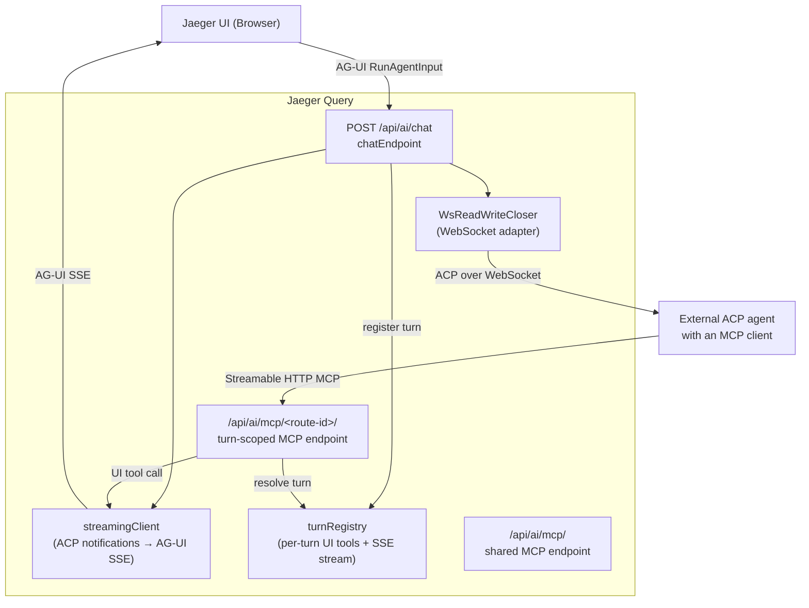
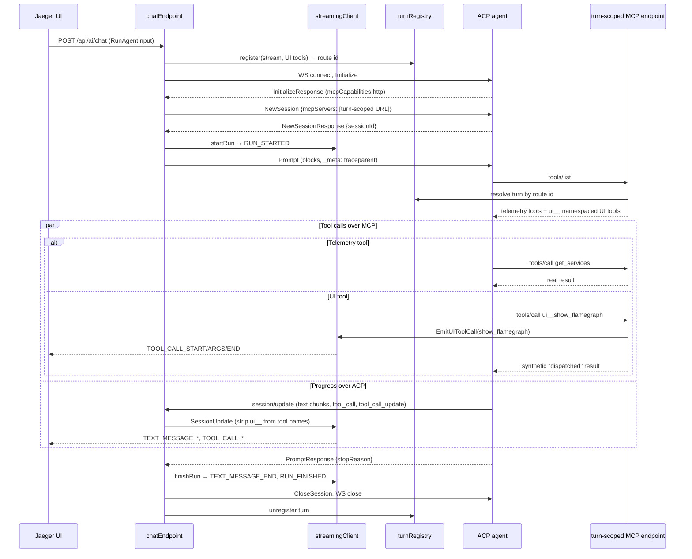

# Jaeger AI Gateway

This package implements the AI gateway in Jaeger Query. It accepts
[AG-UI](https://docs.ag-ui.com/) chat requests from the Jaeger UI, speaks the
[Agent Client Protocol (ACP)](https://agentclientprotocol.com/) to an external
agent, and streams AG-UI Server-Sent Events (SSE) back to the browser.

Agents use Jaeger's turn-scoped [MCP](https://modelcontextprotocol.io/)
endpoint for every tool call. That endpoint serves Jaeger telemetry tools and,
for a chat turn, the UI tools declared by the browser.

## Architecture



The shared endpoint serves the telemetry tools to external MCP clients with no
chat turn involved; see the
[`mcptools` README](../mcptools/README.md). The turn-scoped endpoint serves the
same telemetry tools plus the calling turn's UI tools from the same
`mcp.Server`.

## Components

### chatEndpoint (`endpoint_chat.go`)

The chat endpoint is registered at `POST /api/ai/chat` only when
`extensions.jaeger_query.ai.agent_url` is configured. It accepts AG-UI
[`RunAgentInput`](https://docs.ag-ui.com/concepts/run-input) payloads
(`messages`, `tools`, `context`, `threadId`, `runId`), establishes the ACP
WebSocket connection, runs the ACP session lifecycle, and streams AG-UI events
back to the browser. It passes the request's `threadId` and `runId` to the
`streamingClient` so the SSE events match what the AG-UI client expects.

### streamingClient (`streaming_client.go`)

`streamingClient` implements the ACP `Client` interface for one chat turn and
writes AG-UI SSE frames into the HTTP response.

- **Run lifecycle.** `startRun`, `finishRun`, and `failRun` emit `RUN_STARTED`,
  `RUN_FINISHED`, and `RUN_ERROR`. Assistant text is bracketed with
  `TEXT_MESSAGE_START` and `TEXT_MESSAGE_END`.
- **`SessionUpdate`.** Maps ACP `session/update` notifications to AG-UI events:
  `AgentMessageChunk` to `TEXT_MESSAGE_CONTENT`; `ToolCall` to
  `TOOL_CALL_START`, plus `TOOL_CALL_ARGS` when `RawInput` is set;
  `ToolCallUpdate` to `TOOL_CALL_ARGS`, `TOOL_CALL_RESULT`, or `TOOL_CALL_END`
  depending on which fields are populated. Thought chunks and plans are
  accepted and dropped. Tool-call notifications are progress display only: the
  tool calls themselves travel over MCP (below), not over ACP. The tool name in
  a notification is the name the agent was offered, so a UI tool arrives with
  `UIToolPrefix`, which is stripped before the event reaches the browser.
- **`EmitUIToolCall`.** Called from the MCP endpoint when the agent invokes a UI
  tool. Emits `TOOL_CALL_START`, `TOOL_CALL_ARGS`, and `TOOL_CALL_END` under the
  bare name the browser registered.
- **`RequestPermission`.** Answers `session/request_permission` by selecting the
  first option of kind `allow_once` or `allow_always`, and cancels if the agent
  offers neither. The gateway advertises no filesystem or terminal capability in
  `Initialize`, so a well-behaved agent has nothing else to ask about.

A mutex guards its mutable state because ACP updates may arrive from a
different goroutine than the one driving `Prompt`, while lifecycle calls come
from the chat endpoint and UI tool calls from the MCP endpoint.

### WsReadWriteCloser (`ws_adapter.go`)

`WsReadWriteCloser` adapts a gorilla WebSocket connection to the
`io.ReadWriteCloser` interface required by the ACP runtime. It presents
discrete WebSocket messages to the SDK as a newline-delimited byte stream and
sends SDK writes as WebSocket text messages.

## Request flow



1. The gateway parses the AG-UI `RunAgentInput`, collecting the latest user
   message and any context entries into ACP prompt blocks. A `tools` entry
   with an empty or whitespace name is rejected with a 400 before any agent
   work happens.
2. It serializes the request's UI-tool declarations and registers them with a
   new turn. The turn registry gives the agent a unique MCP route and holds
   the browser SSE stream for that turn.
3. It creates a standard ACP client connection, runs `Initialize`, then
   `NewSession`. When the agent advertises HTTP MCP support and
   `ai.mcp.base_url` is available, the session announces the turn-scoped MCP
   URL.
4. It emits `RUN_STARTED` and sends `Prompt`, with the request's trace context
   in `_meta` so an agent that propagates it joins its spans to the request's
   trace. While the prompt runs, the agent calls tools over MCP and reports
   progress over ACP; the two legs are concurrent.
5. When the prompt finishes, it closes the ACP session, unregisters the turn,
   and emits `RUN_FINISHED` or `RUN_ERROR`.

## MCP tool routing

The agent calls the announced turn-scoped endpoint using standard MCP
`tools/list` and `tools/call` requests. The UI-tools middleware in
`mcp_ui_tools.go` layers the turn's UI tools onto the shared telemetry server:

- **Telemetry tools** execute against Jaeger's in-process query service and
  return their results to the agent.
- **UI tools** are the browser-supplied tools attached to the active turn.
  `tools/list` advertises each one as `UIToolPrefix` (`ui__`) plus its frontend
  name. A `tools/call` with that prefix is a UI tool: the gateway strips the
  prefix, confirms the turn declared the tool, emits `TOOL_CALL_*` events over
  the browser's SSE stream under the bare name, and returns a synthetic
  dispatched result immediately. A prefixed name the turn never declared is
  rejected as a tool error, so an agent cannot dispatch a UI tool the frontend
  did not offer. Unprefixed names fall through to the telemetry handlers.

The namespace exists so a UI tool can never shadow a telemetry tool of the same
name. The frontend chooses UI tool names per request, so without a namespace
the agent's telemetry capability would depend on what the browser happened to
send. The double underscore follows the convention MCP aggregators use for
sub-domain prefixes, which keeps a coincidental clash with a telemetry tool
name contrived.

UI tools are fire-and-forget by design. They are commands such as
`show_flamegraph(trace_id)` rather than queries, so there is no result to
return to the model. The browser performs the side effect when it sees the
`TOOL_CALL_*` events, and the synthetic result lets the model's loop continue
to a final answer in the same turn. The browser cannot return a value during
the turn; RFC 0008 §4.4 records that as an implementation limit, not a protocol
one.

The external-agent contract and the Goose worked example are documented in
[`scripts/ai-sidecar/README.md`](../../../../../../../scripts/ai-sidecar/README.md).

## Configuration

```yaml
extensions:
  jaeger_query:
    ai:
      agent_url: "ws://localhost:16688"
      agent_headers:
        Authorization: Bearer ${env:MY_AGENT_TOKEN}
      mcp:
        base_url: "http://localhost:16686"
```

`agent_url` is the external agent's WebSocket URL. `agent_headers` are sent on
every dial and redacted from logs. `mcp.base_url` is the address that the
agent can use to call Jaeger's MCP endpoint. When both ends are on the same
loopback host, the gateway can infer a suitable MCP URL; other deployments
should configure it explicitly.

## Related code

- `endpoint_chat.go` owns the chat HTTP and ACP lifecycle.
- `endpoint_turn_mcp.go` and `turn_registry.go` provide the per-turn MCP
  route and lifecycle.
- `mcp_ui_tools.go` exposes browser UI tools through MCP under `UIToolPrefix`.
- `streaming_client.go` translates ACP notifications into AG-UI SSE events.
- `translation.go` holds the AG-UI to ACP helpers, including the prefix strip.
- `ws_adapter.go` adapts the ACP WebSocket transport.
- `../mcptools` serves the shared MCP endpoint and the telemetry tools.

Protocol specifications: [ACP](https://agentclientprotocol.com/) and
[AG-UI](https://docs.ag-ui.com/).
