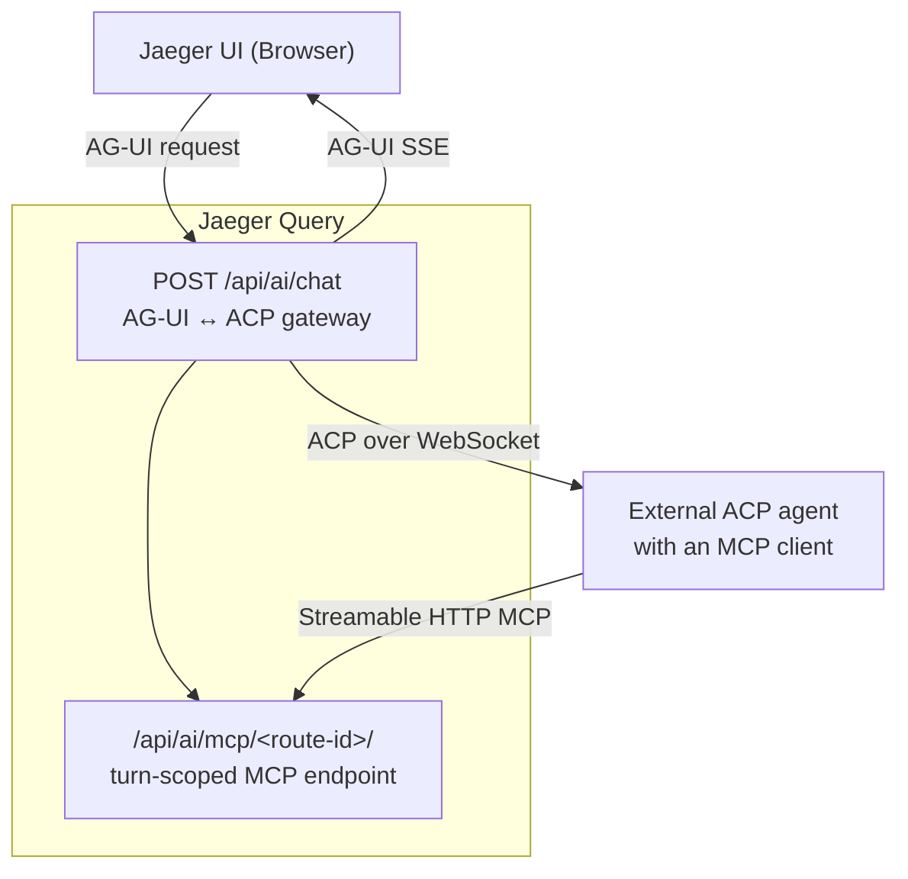

# Jaeger AI Gateway

This package implements the AI gateway in Jaeger Query. It accepts
[AG-UI](https://docs.ag-ui.com/) chat requests from the Jaeger UI, speaks the
[Agent Client Protocol (ACP)](https://agentclientprotocol.com/) to an external
agent, and streams AG-UI Server-Sent Events (SSE) back to the browser.

Agents use Jaeger's turn-scoped [MCP](https://modelcontextprotocol.io/)
endpoint for every tool call. That endpoint serves Jaeger telemetry tools and,
for a chat turn, the UI tools declared by the browser.

## Architecture



## Components

### chatEndpoint (`endpoint_chat.go`)

The chat endpoint is registered at `POST /api/ai/chat` only when
`extensions.jaeger_query.ai.agent_url` is configured. It accepts AG-UI
[`RunAgentInput`](https://docs.ag-ui.com/concepts/run-input) payloads,
establishes the ACP WebSocket connection, runs the ACP session lifecycle, and
streams AG-UI events back to the browser.

### streamingClient (`streaming_client.go`)

`streamingClient` translates ACP `session/update` notifications into AG-UI SSE
events. It maps agent message chunks to text-message events and tool progress
to tool-call events, and handles the run and message lifecycle around those
updates. A mutex guards its mutable state because ACP updates may arrive from a
different goroutine than the one driving `Prompt`, while lifecycle calls come
from the chat endpoint.

### WsReadWriteCloser (`ws_adapter.go`)

`WsReadWriteCloser` adapts a gorilla WebSocket connection to the
`io.ReadWriteCloser` interface required by the ACP runtime. It presents
discrete WebSocket messages to the SDK as a newline-delimited byte stream and
sends SDK writes as WebSocket text messages.

## Chat request flow

The chat endpoint is registered at `POST /api/ai/chat` when
`extensions.jaeger_query.ai.agent_url` is configured.

1. The gateway parses the AG-UI `RunAgentInput`, collecting the latest user
   message and any context entries into ACP prompt blocks.
2. It serializes the request's UI-tool declarations and registers them with a
   new turn. The turn registry gives the agent a unique MCP route and holds
   the browser SSE stream for that turn.
3. It creates a standard ACP client connection, runs `Initialize`, then
   `NewSession`. When the agent advertises HTTP MCP support and
   `ai.mcp.base_url` is available, the session announces the turn-scoped MCP
   URL.
4. It emits `RUN_STARTED`, sends `Prompt`, and translates ACP
   `session/update` notifications into AG-UI text and tool-call events.
5. When the prompt finishes, it closes the ACP session, unregisters the turn,
   and emits `RUN_FINISHED` or `RUN_ERROR`.

No Jaeger-specific ACP extension method is used. An agent that sends an
unknown ACP method receives the protocol's standard `MethodNotFound` response.

## MCP tool routing

The agent calls the announced turn-scoped endpoint using standard MCP
`tools/list` and `tools/call` requests:

- **Telemetry tools** execute against Jaeger's in-process query service and
  return their results to the agent.
- **UI tools** are the browser-supplied tools attached to the active turn. A
  call emits `TOOL_CALL_*` events over the browser's SSE stream and returns a
  synthetic dispatched result immediately. The browser performs the side
  effect; it does not return a result during the same chat turn.

`UIToolPrefix` remains part of the ACP-to-AG-UI translation boundary. When an
agent reports a namespaced UI tool in an ACP progress notification, the
gateway strips the prefix before it writes the AG-UI event so the browser sees
the name it declared.

The external-agent contract and the Goose worked example are documented in
[`scripts/ai-sidecar/README.md`](../../../../../../../scripts/ai-sidecar/README.md).

## Configuration

```yaml
extensions:
  jaeger_query:
    ai:
      agent_url: "ws://localhost:16688"
      mcp:
        base_url: "http://localhost:16686"
```

`agent_url` is the external agent's WebSocket URL. `mcp.base_url` is the
address that the agent can use to call Jaeger's MCP endpoint. When both ends
are on the same loopback host, the gateway can infer a suitable MCP URL; other
deployments should configure it explicitly.

## Related code

- `endpoint_chat.go` owns the chat HTTP and ACP lifecycle.
- `endpoint_turn_mcp.go` and `turn_registry.go` provide the per-turn MCP
  route and lifecycle.
- `mcp_ui_tools.go` exposes browser UI tools through MCP.
- `streaming_client.go` translates ACP notifications into AG-UI SSE events.
- `ws_adapter.go` adapts the ACP WebSocket transport.

Protocol specifications: [ACP](https://agentclientprotocol.com/) and
[AG-UI](https://docs.ag-ui.com/).
