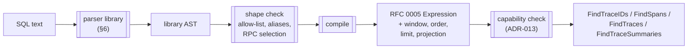

# RFC 0019: SQL as an Input Query Language for Trace Search

- **Status:** Draft
- **Author:** Yuri Shkuro
- **Created:** 2026-10-23
- **Last Updated:** 2026-10-23
- **Related:** [RFC 0005 (structured query filters)](0005-structured-query-filters.md) · [RFC 0016 (span search)](0016-span-search.md) · [RFC 0014 (search result pagination)](0014-search-result-pagination.md) · [RFC 0011 (trace summary API)](0011-trace-summary-api.md) · [ADR-002 (MCP server)](../adr/002-mcp-server.md) · [ADR-013 (storage capability declaration)](../adr/013-storage-capability-declaration.md)

---

## Abstract

Jaeger's search API takes a structured expression tree ([RFC 0005](0005-structured-query-filters.md)). The tree is the right contract between the query service and the storage backends, but it is a poor surface for the clients that increasingly write queries: AI agents. An agent has to learn a closed vocabulary of `op`, `level` and `type` values from in-context documentation and emit a nested JSON document that is ten lines long for a two-predicate conjunction, and nothing in its training prepares it for that vocabulary. The same agent writes SQL fluently, because SQL is the most widely represented query language in any training corpus.

This RFC proposes **a read-only SQL dialect as an input surface** for trace search. A query is a single `SELECT` over a small **virtual schema**: a `spans` relation with the built-in fields and level-qualified attribute maps of RFC 0005, two child relations `events` and `links`, and a `traces` relation with the summary fields of [RFC 0011](0011-trace-summary-api.md). The query service parses the SQL with an existing Go parser, **compiles** the statement to the RFC 0005 expression tree and to the result-shaping clauses that [RFC 0016](0016-span-search.md) reserved, and executes it through the storage API that already exists. No SQL text reaches a backend. The dialect is deliberately small: one statement kind over one relation, no joins, an allow-listed set of constructs, and a refusal with a precise message for everything else.

The reason to choose SQL over a trace-native language such as TraceQL is not expressiveness, where TraceQL is ahead, but familiarity: the surface costs an agent nothing to learn, and it reaches every tier RFC 0005 built or reserved (filtering, result shaping, and later aggregation) with syntax the agent already produces. The structural tier of RFC 0005 (parent, child, descendant, sibling) stays out of scope, as it is there. §4 settles the surface, §5 the compiler, and §6 surveys the Go SQL parsers so that the project does not write one.

---

## 1. Motivation

### 1.1 The structured AST is a contract, not a user surface

RFC 0005 made a deliberate choice: the filter is a typed proto/JSON tree, and "a free-text query language" is a listed non-goal, with the note that a text surface "can compile *to* this AST without changing the contract" ([RFC 0005 §2 and §8](0005-structured-query-filters.md#8-considered-alternatives)). That choice was correct for the storage boundary. A backend lowers a tree; it should not parse text. But the same document's Go builder exists because the tree is hard to write by hand: the package comment of `internal/expression` observes that "a two-predicate conjunction is ten lines of nested Call, Args and reference terms" ([`predicate.go`](../../internal/expression/predicate.go)). Humans get a builder in Go and in the Python SDK. Agents get the raw tree.

### 1.2 Agents are now a primary client

The MCP server ([ADR-002](../adr/002-mcp-server.md), [RFC 0012](0012-mcp-server-extension.md)) exposes `search_traces` and a `read_skill` tool whose purpose is to hand an agent the documentation it needs to form queries. Everything an agent knows about Jaeger's query vocabulary therefore arrives in its context window, per session, and competes for attention with the task itself. A query language the model already knows removes that cost. The text-to-SQL literature measures how well models already know SQL: on the Spider benchmark, prompting alone reaches 86.6% execution accuracy [\[1\]](https://arxiv.org/abs/2308.15363), while on Spider 2.0, whose tasks span several dialects and require consulting dialect documentation, a code agent built on a frontier model solves 21.3% [\[2\]](https://arxiv.org/abs/2411.07763). A dialect that stays inside the relational core, with a schema short enough to fit in a tool description, is the first regime, not the second.

### 1.3 The tiers above filtering are SQL clauses already

RFC 0005 named its tiers in SQL's own terms: L2 is the `WHERE` clause, L3 is `SELECT`/`ORDER BY`/`LIMIT`, L4 is `GROUP BY` ([RFC 0005 §4](0005-structured-query-filters.md#4-composition--the-query-complexity-continuum)), and [RFC 0016 §5](0016-span-search.md#5-provisioning-for-select-and-group-by) reserved `projection`, `group_by` and `having` fields with those names. A structured request grows one proto field per tier, and an agent has to learn each field. A SQL statement grows one clause per tier, and the agent knew the clause before it met Jaeger. The same surface therefore serves the filter that exists today, the span search that RFC 0016 adds, and the aggregation RPC that RFC 0016 leaves for later, without a new vocabulary at any step.

### 1.4 What SQL does not buy

SQL is not a better language for traces than TraceQL. TraceQL's spanset pipeline, its `childCount` and `rootService` intrinsics, and its metrics stage are purpose-built and compact [\[3\]](https://grafana.com/docs/tempo/latest/traceql/construct-traceql-queries/). SQL's row-at-a-time model makes "return the trace" a subquery, and it has no native way to say "a span whose descendant matches" short of a self-join or a recursive query. This RFC accepts the first and declines the second: the structural tier of RFC 0005 (its L5) stays deferred, and joins are out of scope (§2), because a self-join over a trace is a different execution model from the single-relation filter every backend evaluates today, and nothing in SQL's syntax makes that model cheaper to build. The target users produce queries from a prompt and read results as data, so SQL's verbosity costs them little and its familiarity buys them a lot. §4.5 lists what the dialect refuses.

---

## 2. Goals and non-goals

### Goals

- **G1. One statement, familiar syntax.** A single `SELECT … FROM … WHERE … [ORDER BY …] [LIMIT …]` statement in the relational core of SQL, with no Jaeger-specific keywords. Any construct outside the allow-list is refused at compile time with a message that names the construct and the allowed alternative.
- **G2. Compile to the existing contract.** The statement compiles to the RFC 0005 `Expression` for its `WHERE` clause and to the ordering, limit and projection fields that RFC 0016 reserves. Storage backends are not changed by this RFC, and no SQL text crosses the storage API.
- **G3. Agent-grade errors.** Every refusal carries a line and column, the offending construct, and what the dialect accepts in its place. An agent corrects a query from its error; a bare "syntax error" is a failure of this RFC.
- **G4. Capability honesty.** A query that compiles to a shape the deployment's storage cannot evaluate is refused the way RFC 0005 refuses an undeclared operator, through the capability declaration of [ADR-013](../adr/013-storage-capability-declaration.md), never approximated.
- **G5. A dry run.** A caller can compile a statement without executing it and receive the normalized SQL, the compiled expression, and the warnings.
- **G6. No new parser.** The lexer and parser come from an existing, maintained, pure-Go library (§6).

### Non-goals

- **Data modification, DDL, transactions, multiple statements.** The dialect is one `SELECT`.
- **Joins, and the structural tier.** A statement reads one relation. Self-joins over `spans` would be the SQL spelling of RFC 0005's tier L5 (parent, child, descendant, sibling), but that tier needs a fetch-then-filter execution model that no backend has, and RFC 0005 deferred it to a separate effort for that reason. This RFC does not change that decision; a later RFC that builds L5 may give it a SQL spelling.
- **Aggregation (`GROUP BY`, `HAVING`, aggregate functions).** Parsed and recognized, but refused until the row-returning RPC that [RFC 0016 §5](0016-span-search.md#5-provisioning-for-select-and-group-by) deliberately leaves unnamed exists. This RFC reserves the clause mapping (§4.4) and does not build it.
- **Passing SQL through to a storage engine.** ClickHouse speaks SQL and OpenSearch has a SQL plugin, but §7 shows why neither is this RFC's design.
- **A SQL surface for the Jaeger UI.** The UI could grow a "SQL mode" search box over the same endpoint; that is jaeger-ui work and is listed in §9 as optional.
- **Replacing the structured filter.** The RFC 0005 tree remains the contract and the Go and Python builders remain the programmatic surface. SQL is a third way to produce the same tree.

---

## 3. Current state

Three facts about the code shape the design.

**The filter is already an expression tree with a closed vocabulary.** `jaeger-idl/query/expression/v1` defines sixteen operators (`and`, `or`, `not`, `eq`, `ne`, `gt`, `lt`, `gte`, `lte`, `regex`, `exists`, `in`, `not_in`, `some`, `phrase`, `fulltext`), five levels, and a per-level list of built-in fields (`traceID`, `spanID`, `parentSpanID`, `name`, `kind`, `startTime`, `endTime`, `duration`, `status`, `statusMessage` on the span; `service` and `schemaURL` on the resource; and so on). A constant travels as text with an optional type hint, and `tracestore.ResolveFilterConstants` reads it as the type of the field beside it, so `duration > "2s"` is already a valid and typed comparison ([RFC 0005 §5.4](0005-structured-query-filters.md#54-typed-values)). A SQL `WHERE` clause over these names is a one-to-one rewrite.

**The result shape is settled per RPC.** `FindTraces` returns whole traces, `FindTraceIDs` identities, `FindTraceSummaries` per-trace statistics (RFC 0011), and `FindSpans` (RFC 0016) the matching spans with ordering and a keyset cursor (RFC 0014). RFC 0016 reserved `projection`, `group_by` and `having` fields and concluded that aggregation needs a separate row-returning RPC. The SQL compiler's job is to pick the RPC from the statement's shape (§4.4), not to invent a result type.

**Capabilities are declared.** Each backend declares the levels and operators it evaluates (`FilterCapabilities`), and the query service refuses a filter the backend did not declare. A SQL statement compiles to the same filter, so the same check applies to it with no new mechanism.

---

## 4. The dialect

### 4.1 Virtual schema

The dialect exposes four relations. None is a physical table; each is a name the compiler resolves to a level, a field, or an RPC. A statement reads `spans` or `traces` in its `FROM` clause; `events` and `links` appear only inside an `EXISTS` subquery (§4.3).

| Relation | One row per | Columns |
|---|---|---|
| `spans` | span | `trace_id`, `span_id`, `parent_span_id`, `name`, `kind`, `start_time`, `end_time`, `duration`, `status`, `status_message`, `trace_state`, `service`, `scope_name`, `scope_version`, `attributes`, `resource_attributes`, `scope_attributes` |
| `events` | span event | `trace_id`, `span_id`, `name`, `time`, `time_since_start`, `attributes` |
| `links` | span link | `trace_id`, `span_id`, `linked_trace_id`, `linked_span_id`, `trace_state`, `attributes` |
| `traces` | trace | `trace_id`, `root_service`, `root_name`, `start_time`, `duration`, `span_count`, `error_count` (the RFC 0011 summary fields) |

Column names are the RFC 0005 field names in `snake_case`, because that is the case every SQL corpus uses and the case ClickHouse's own schema uses. The compiler also accepts the `camelCase` spelling of the IDL (`parentSpanId`, `startTime`) and normalizes it, so a model that has read the API documentation is not punished for it.

`attributes` and its two siblings are **map-typed columns** addressed by subscript, `attributes['http.status_code']`. The subscript on `spans.attributes` compiles to an `AttributeRef` at the span level, `resource_attributes[…]` to the resource level, `scope_attributes[…]` to the scope level, and the subscript on `events.attributes` and `links.attributes` to the event and link levels. The unqualified RFC 0005 search over span-or-resource is spelled with the function `attr('key')`, which has no level, exactly like the legacy `attributes` map; it exists because a model that has only been told "attribute `k`" should have a way to say it without choosing a level it does not know. Map subscript is the one construct here that is not in SQL-92. It is in ClickHouse, PostgreSQL (`hstore`, arrays), DuckDB, BigQuery and Spark SQL, and models produce it readily; §6 treats parser support for it as a hard criterion.

### 4.2 Predicates

The `WHERE` clause is a boolean expression over the columns above and compiles to the RFC 0005 tree by the following mapping. Everything not in the table is refused.

| SQL | Expression `op` | Notes |
|---|---|---|
| `AND`, `OR`, `NOT`, parentheses | `and`, `or`, `not` | flattened as the Go builder flattens |
| `=`, `<>` / `!=`, `>`, `<`, `>=`, `<=` | `eq`, `ne`, `gt`, `lt`, `gte`, `lte` | ordered operators obey the RFC 0005 domain rules; `kind > 'server'` is refused |
| `x IN (a, b)`, `x NOT IN (…)` | `in`, `not_in` | literal lists only; a subquery on the right is refused except the `trace_id IN (SELECT …)` shape of §4.4 |
| `x REGEXP 'regex'`, `match(x, 'regex')` | `regex` | two spellings for one operator, because models produce both; PostgreSQL's `~` is not in the parser's grammar and is a parse error |
| `x IS NOT NULL`, `x IS NULL` | `exists`, `not(exists)` | on attribute references only; built-in fields always exist |
| `x LIKE '%a_b%'`, `x LIKE 'exact'` | `regex`, `eq` | `LIKE` is what models reach for first. RFC 0005's `regex` matches anywhere in the value and refuses anchors, so a pattern with `%` at both ends compiles to the regex between them (`%`→`.*`, `_`→`.`) and a pattern without wildcards to `eq`; a pattern anchored at one end, `LIKE 'GET%'`, has no equivalent and is refused with that explanation. `ILIKE` is refused because `regex` is case-sensitive |
| `phrase(x, 'word word')`, `fulltext(x, 'word word')` | `phrase`, `fulltext` | functions, because SQL has no standard text-search operator |
| `EXISTS (SELECT … FROM events e WHERE e.span_id = s.span_id AND …)` | `some` over events | §4.3 |
| `EXISTS (SELECT … FROM links l WHERE l.span_id = s.span_id AND …)` | `some` over links | §4.3 |

**Literals.** Strings are single-quoted. Numbers are integers or decimals. Booleans are `true`/`false`. A duration is written as a string with a unit, `'2s'`, `'250ms'`, which is the form the RFC 0005 `DurationValue` already takes, or as the standard `INTERVAL '2' SECOND`, which the compiler normalizes to the former. A timestamp is an RFC 3339 string, `'2026-10-23T12:00:00Z'`, typed by the `start_time` beside it exactly as RFC 0005 types it, or `now() - INTERVAL '1' HOUR`, the only arithmetic the dialect allows; `now()` is evaluated once per request by the query service. The SQL-92 `TIMESTAMP '…'` literal is not in the parser's grammar and is a parse error. A constant carries no type on the wire; it is typed by the field beside it, as RFC 0005 §5.4 specifies, so `duration > 2000` is refused with the message that a duration needs a unit, and `attributes['retries'] > 3` is passed through for storage to compare numerically.

**Time window.** Jaeger requires a start-time window on every search. The compiler extracts it from the top-level conjuncts of `WHERE` that bound `start_time` on the primary `spans` alias, both bounds required, and puts them in `start_time_min` and `start_time_max` of the request. A statement without both bounds is refused with a message that shows the two conjuncts to add. The window is taken out of the compiled filter so that the backends' time handling is unchanged. A second `start_time` predicate deeper in the tree stays in the filter.

### 4.3 Events and links

A span's events and links are collections, and RFC 0005 §5.5 shows why a conjunction of two event predicates without a quantifier is wrong: each conjunct may be satisfied by a different event. SQL's own existential is the fix, and it is the one SQL construct every model knows for this purpose:

```sql
SELECT * FROM spans s
WHERE s.start_time >= now() - INTERVAL '1' HOUR AND s.start_time < now()
  AND s.service = 'checkout'
  AND EXISTS (
    SELECT 1 FROM events e
    WHERE e.span_id = s.span_id AND e.trace_id = s.trace_id
      AND e.name = 'exception'
      AND e.attributes['exception.type'] = 'TimeoutError'
  )
```

The compiler recognizes the subquery by shape: `FROM events` or `FROM links`, a correlation on `span_id` (and optionally `trace_id`) to the outer alias, and a `WHERE` over the child relation's columns only. It compiles to `some(events, <inner predicate>)`. A correlated subquery of any other shape is refused with a message that shows this one. An `events` or `links` relation in the outer `FROM` is also refused; it would make the result one row per event, which no RPC returns.

### 4.4 Statement shape selects the RPC

The query service picks the RPC from the `SELECT` list and the `FROM` relation, because the RPCs differ in what they return and the statement already says what the caller wants.

| Statement shape | RPC | Compiled fields |
|---|---|---|
| `SELECT DISTINCT trace_id FROM spans WHERE …` | `FindTraceIDs` | filter, window, limit, cursor |
| `SELECT * FROM spans WHERE …` | `FindSpans` (RFC 0016) | filter, window, order, limit, cursor |
| `SELECT span_id, duration, … FROM spans WHERE …` | `FindSpans` | the above plus a reference-only `projection` |
| `SELECT * FROM traces WHERE trace_id IN (SELECT trace_id FROM spans WHERE …)` | `FindTraces` | the inner filter and window; `LIMIT` on the outer query is `search_depth` |
| `SELECT trace_id, root_service, span_count, … FROM traces WHERE trace_id IN (…)` | `FindTraceSummaries` (RFC 0011) | as above |
| `SELECT … FROM spans … GROUP BY …`, any aggregate function | refused | reserved for the RPC of RFC 0016 §5 |

`ORDER BY` accepts the fields RFC 0016 §6 declares sortable (`start_time`, `duration`, `trace_id`, `span_id`) and compiles to its ordering message; any other column is refused with the list. `LIMIT n` compiles to the page size, capped by the server's configured maximum, and `OFFSET` is refused in favor of the keyset cursor, which the response carries and the request accepts as a field beside the SQL. A `traces` query without the `IN (SELECT …)` shape is refused, because a trace predicate alone has nothing to search on; a later RFC may let `traces.duration > '5s'` compile to a summary-level filter if a backend indexes it.

### 4.5 What the dialect refuses, by design

- Arithmetic other than `now() - INTERVAL`, string functions, `CASE`, `CAST`, window functions. None has a target in the expression tree. `CAST` is tempting for `attributes['x']::int`, but RFC 0005 already types a constant from the stored attribute and a cast would state a type the query cannot know.
- `JOIN` of any kind, `UNION`, `WITH`, derived tables in `FROM`, scalar subqueries in `SELECT`. A statement reads one relation (§2). The refusal for a self-join on `spans` says so and points at RFC 0005's structural tier, because that is the question the agent was asking.
- `GROUP BY`, `HAVING`, aggregates, until the row RPC exists.
- `OFFSET`, for the reason RFC 0014 gives: deep offsets are the pathological case of every backend.

---

## 5. The compiler

The compiler is one Go package in the query service, `internal/sqlquery` (name illustrative), with three stages and no storage knowledge.



**Parse** is the library's job. Its output is the library's AST for the whole statement, including constructs the dialect will refuse; a full-dialect parser is an asset here, because a model that writes `GROUP BY` gets "aggregation is not supported yet" instead of a tokenizer error at the first unexpected keyword.

**Shape check** walks the AST once and decides three things: that the statement is a single `SELECT` with no refused clause; the alias graph (the one `spans` or `traces` alias, and which correlated subqueries are `events`/`links`); and the RPC from §4.4. Every rejection here is built from a small catalog of error templates, each with the construct's position and a "did you mean" that lists the admitted alternatives. The catalog is a test fixture: every template is exercised by a statement that triggers it, and the tests assert the message text, because the message *is* the agent's documentation at the moment it matters.

**Compile** rewrites the `WHERE` tree of each `spans` alias into an RFC 0005 `Call`, reusing `internal/expression` so that the output is exactly what the Go builder would produce for the same query, and then runs `tracestore.FinalizeFilter` on it, which validates the tree and resolves every constant against the field beside it. The window, order, limit and projection are filled into the request message.

**Normalized SQL.** The compiler also prints the statement back from the AST through the parser's formatter, which fixes keyword case, spacing and the `AS` of every alias while keeping identifiers and literals as written. The dry-run RPC returns it, the MCP tool echoes it beside the results, and query logs record it, so that two agents asking the same question in different spellings leave one footprint.

### 5.1 API surface

Three additions, all additive:

1. **A `sql` field** (`string`) on `TraceQueryParameters` and `SpanQueryParameters` in api_v3, in the same mutual-exclusion group as `filter` and the legacy predicate fields. The HTTP gateway takes it as a query parameter or request-body field; the gRPC service as the field. The query service compiles it before anything else looks at the request, so storage, capability checks and admission see a request indistinguishable from one that arrived with `filter`.
2. **`ExplainQuery`** (name provisional), an RPC taking the SQL and returning the normalized SQL, the compiled `Expression`, the chosen RPC, the extracted window, and the warnings, or the error. It is the dry run of G5. It is also what a UI "SQL mode" would call for inline validation.
3. **The MCP `search_traces` tool** gains the `sql` input alongside its existing inputs, and the skill it serves through `read_skill` gains a section with the virtual schema and ten example statements. For an agent, this is the whole feature; the two items above exist so that the MCP server is not the only client.

---

## 6. Choosing a parser

The project should not write a SQL parser. The dialect of §4 is a strict subset of the standard `SELECT` grammar, and every mature SQL parser accepts it, so any of them can produce the AST that §5's shape check walks. The question is which library fits Jaeger's constraints. The constraints, in order of weight:

- **Pure Go.** Jaeger builds with `CGO_ENABLED=0` into static binaries and distroless images. A cgo dependency is disqualifying.
- **Dialect fit.** The parser must accept, as syntax, the constructs §4 needs: map subscript `m['k']`, `EXISTS (SELECT …)` correlated subqueries, `INTERVAL` literals, `IS NULL`, `IN (…)`, `ORDER BY`/`LIMIT`, and `DISTINCT`. Every parser in the survey is a parser for a SQL dialect, and each dialect's `SELECT` is a superset of this list except where the table in §6.2 says otherwise; the dialect's name says which vendor's extensions it also accepts, not that it departs from SQL. ClickHouse SQL in particular is standard SQL plus extensions, and is not to be confused with Cassandra's CQL, which is not SQL and has no parser in this survey. Everything else it accepts is refused by the shape check, so over-acceptance costs nothing.
- **Footprint.** The modules and packages a `go get` adds, and what they drag into the binary.
- **AST ergonomics.** A typed, walkable AST with source positions on every node (G4 is impossible without positions), and a printer that can emit the normalized SQL of §5.
- **Maintenance.** Recent releases, more than one maintainer or a sponsoring organization, a license compatible with Apache-2.0.
- **Familiarity of the dialect to models.** Secondary, because the subset is the common core, but a parser whose base dialect models write by default yields fewer spurious parse errors on the fringes (quoting, `!=` versus `<>`, backticks).

### 6.1 Candidates

The survey covers every pure-Go SQL parser with a release in the last two years and the two options that are not libraries, writing a grammar and calling a storage engine's own SQL. Versions and dates were resolved with `go list -m` on 2026-10-23 and from each project's repository.

| Library | Dialect | Version / activity | License | Runtime deps |
|---|---|---|---|---|
| `vitess.io/vitess/go/vt/sqlparser` [\[4\]](https://pkg.go.dev/vitess.io/vitess/go/vt/sqlparser) | MySQL | v0.24.5, Oct 2026 | Apache-2.0 | 16 Vitess-internal packages (`sqltypes`, `proto/query`, `collations`, `decimal`, …) |
| `github.com/pingcap/tidb/pkg/parser` [\[5\]](https://pkg.go.dev/github.com/pingcap/tidb/pkg/parser) | MySQL | pseudo-version, Oct 2026 | Apache-2.0 | 14 direct: `pingcap/errors`, `pingcap/log`, `zap`, `failpoint`, five `modernc.org/*`, `go-sql-driver/mysql`, … |
| `github.com/cockroachdb/cockroachdb-parser` [\[6\]](https://github.com/cockroachdb/cockroachdb-parser) | PostgreSQL | v0.25.2, Jun 2025; **repository archived** | Apache-2.0 | CockroachDB `errors`, `apd`, `redact`, … |
| `github.com/wasilibs/go-pgquery` [\[7\]](https://github.com/wasilibs/go-pgquery) | PostgreSQL (the real `libpg_query`, compiled to Wasm) | pseudo-version, Oct 2026 | MIT (libpg_query BSD-3) | `wazero`, `pg_query_go` types, an embedded Wasm module |
| `github.com/pganalyze/pg_query_go` | PostgreSQL | v6, active | BSD-3 | **cgo** |
| `github.com/rqlite/sql` [\[8\]](https://github.com/rqlite/sql) | SQLite | pseudo-version, Oct 2026 | MIT | none (one test-only) |
| `github.com/AfterShip/clickhouse-sql-parser` [\[9\]](https://github.com/AfterShip/clickhouse-sql-parser) | ClickHouse | v0.5.6, Aug 2026 | MIT | none |
| `github.com/akito0107/xsqlparser` [\[10\]](https://github.com/akito0107/xsqlparser) | ANSI (port of `sqlparser-rs`) | v1.0.0, May 2022 | Apache-2.0 | none |
| `github.com/alecthomas/participle/v2` [\[11\]](https://github.com/alecthomas/participle), own grammar | the §4 subset exactly | v2.1.4, Mar 2025; already an indirect dependency of Jaeger | MIT | none |
| ANTLR4 Go runtime + `grammars-v4` SQL grammar | any | active | BSD-3 | runtime plus a generated parser of several megabytes |

### 6.2 Assessment

🟢 good · 🟨 partial or caveated · ❌ poor

| Criterion | Vitess | TiDB | CRDB parser | go-pgquery | rqlite/sql | ClickHouse parser | xsqlparser | participle grammar | ANTLR |
|---|:-:|:-:|:-:|:-:|:-:|:-:|:-:|:-:|:-:|
| Pure Go, no cgo | 🟢 | 🟢 | 🟢 | 🟨¹ | 🟢 | 🟢 | 🟢 | 🟢 | 🟢 |
| Map subscript `m['k']` | ❌² | ❌² | 🟢 | 🟢 | ❌³ | 🟢 | ❌ | 🟢 | 🟢 |
| `EXISTS`, `INTERVAL`, `IN` | 🟢 | 🟢 | 🟢 | 🟢 | 🟨⁴ | 🟢 | 🟨 | 🟢⁵ | 🟢 |
| Footprint | ❌⁶ | 🟨⁷ | ❌ | 🟨⁸ | 🟢 | 🟢 | 🟢 | 🟢 | ❌⁹ |
| Positions on nodes | 🟢 | 🟢 | 🟢 | 🟨¹⁰ | 🟢 | 🟢 | 🟢 | 🟢 | 🟢 |
| Walk/visitor and printer | 🟢 | 🟢 | 🟢 | 🟢 | 🟢 | 🟢 | 🟢 | 🟨¹¹ | 🟨 |
| Maintenance | 🟢 | 🟢 | ❌¹² | 🟨¹³ | 🟨¹⁴ | 🟨¹⁵ | ❌¹⁶ | 🟢 | 🟢 |
| License | 🟢 | 🟢 | 🟢 | 🟢 | 🟢 | 🟢 | 🟢 | 🟢 | 🟢 |
| Dialect familiar to models | 🟢 | 🟢 | 🟢 | 🟢 | 🟢 | 🟨¹⁷ | 🟢 | 🟢 | 🟢 |
| No grammar for Jaeger to own | 🟢 | 🟢 | 🟢 | 🟢 | 🟢 | 🟢 | 🟢 | ❌¹⁸ | ❌¹⁸ |

- ¹ `go-pgquery` avoids cgo by running `libpg_query` under the `wazero` WebAssembly runtime; the project's own benchmarks put a `SELECT` parse at about 25 µs, four to five times the cgo figure, which is immaterial at Jaeger's query rates.
- ² MySQL has no subscript syntax; an attribute would have to be spelled `JSON_EXTRACT(attributes, '$.k')` or `attributes->>'$.k'`, which models produce less reliably and which reads as a JSON column rather than a map.
- ³ SQLite has no subscript either; the function spelling `attr('k')` would have to be the only one, and `resource_attr('k')` for levels. Workable, but it gives up the one construct §4.1 argues for.
- ⁴ `rqlite/sql` parses `EXISTS` and `IN`, but has no `INTERVAL` literal; a duration would be the `'2s'` string form only.
- ⁵ with a grammar the project writes, so "fit" is by construction and the cost moves to the last row.
- ⁶ the import graph pulls `sqltypes`, the MySQL collation tables, the `query` protobufs and the decimal package; the module is the whole of Vitess, so `go.sum` grows by hundreds of lines and the binary by several megabytes.
- ⁷ a standalone module since the TiDB monorepo split it out, but its `go.mod` requires `zap`, `pingcap/log`, `failpoint` and five `modernc.org` packages, and the parser needs a value-driver package imported for literals.
- ⁸ `wazero` is a sizeable pure-Go runtime and the `libpg_query` Wasm module is embedded in the binary; together they add several megabytes.
- ⁹ ANTLR's generated Go parsers for a full SQL grammar run to megabytes of source and are slow to compile; the runtime is a further dependency.
- ¹⁰ the parse tree is PostgreSQL's own, which carries a byte `location` per node but no end position or line/column, so the compiler would compute them.
- ¹¹ `participle` fills `Pos`/`EndPos` on every node, but a printer is the project's to write.
- ¹² the repository is archived and read-only; the last snapshot tracks CockroachDB v25.2.
- ¹³ one maintainer, 60 stars, no tagged release; the upstream `libpg_query` it wraps is healthy.
- ¹⁴ maintained by the rqlite project, which depends on it, and updated in October 2026; effectively one maintainer.
- ¹⁵ a single vendor's project, version 0.x, 255 stars, but with a visible downstream list (SigNoz, Akvorado, Trickster, Altinity's MCP server) that gives it more than one reason to be kept working.
- ¹⁶ last release in 2022.
- ¹⁷ models write ClickHouse SQL competently and the §4 subset is common to every dialect; the residual risk is a model volunteering ClickHouse-only functions (`arrayExists`, `toStartOfMinute`, `SETTINGS`), which the shape check refuses by name.
- ¹⁸ a grammar is a new artifact for Jaeger to own, test and extend, which is the wheel this RFC declines to reinvent even though the §4 subset would be a small one.

### 6.3 Recommendation

**This RFC recommends `github.com/AfterShip/clickhouse-sql-parser`, with `github.com/rqlite/sql` as the named runner-up.**

The rows that decide it are dialect fit and footprint. The ClickHouse parser is the only zero-dependency candidate that accepts every construct of §4 as native syntax, including the map subscript, with no runtime dependencies at all; it exposes positions, `Walk`/`Find`/`Transform` helpers and a formatter that produces the normalized SQL for free. It is also the dialect of Jaeger's primary new backend, so a contributor who works on the ClickHouse lowering already reads it. The rows it loses matter less: the maintenance caveat is real but mitigated by its downstream users, and the dialect-familiarity caveat is about functions the compiler refuses by name anyway. The MySQL parsers are the best-maintained libraries in the survey and lose only on footprint and the missing subscript; if the subscript were dropped in favor of `attr('k')`, Vitess would be the choice over TiDB for its cleaner API, at the cost of the heaviest import graph. `rqlite/sql` is the lightest option and parses everything but `INTERVAL` and the subscript; it is the fallback if the spike in M0 finds the ClickHouse parser's error reporting or coverage wanting. `go-pgquery` would be the pick if the question were "parse arbitrary PostgreSQL", which it is not.

The M0 spike (§9) confirmed the choice. The parser accepted every statement of the corpus except three spellings, each a parse error with a position and the token it choked on: PostgreSQL's `~` operator, the SQL-92 `TIMESTAMP '…'` literal, and `EXISTS (SELECT * …)`, which parses only with a scalar select list such as `SELECT 1`. The dialect writes around all three (§4.2, §4.3). Every other refusal in the corpus is the compiler's own, placed at the construct by the node positions the AST carries. `rqlite/sql` was not needed.

A parser is an implementation detail behind the compiler: the shape check consumes the library's AST and emits Jaeger's. If the library is replaced later, the compiler's tests, which are statements in and expression trees out, are unchanged.

---

## 7. Considered alternatives

🟢 good · 🟨 partial or caveated · ❌ poor

| Criterion | A. SQL compiled to the AST (this RFC) | B. TraceQL-style trace-native language | C. Pass SQL through to the storage engine | D. Keep the structured AST only; better agent docs |
|---|:-:|:-:|:-:|:-:|
| Models produce it without in-context grammar | 🟢 | ❌¹ | 🟢 | ❌ |
| Reaches RFC 0005's L3 and L4 tiers without new vocabulary | 🟢² | 🟢 | 🟢 | ❌ |
| Backend portability | 🟢 | 🟢 | ❌³ ⁴ | 🟢 |
| Safety (no injection, bounded cost) | 🟢 | 🟢 | ❌⁵ | 🟢 |
| Compactness of a typical query | 🟨 | 🟢 | 🟨 | ❌ |
| Implementation cost | 🟨 | ❌⁶ | 🟢 | 🟢 |
| Storage contract unchanged | 🟢 | 🟢 | ❌ | 🟢 |

- ¹ TraceQL has fifteen structural operators and a spanset pipeline syntax [\[3\]](https://grafana.com/docs/tempo/latest/traceql/construct-traceql-queries/); no search found evidence on how reliably models produce it, and a Jaeger dialect of it would have even less representation.
- ² `ORDER BY`/`LIMIT` and a column list today, `GROUP BY` when the row RPC of RFC 0016 §5 exists; §4.4.
- ³ Elasticsearch SQL and the OpenSearch SQL plugin restrict nested fields to one per query and refuse multi-valued fields by default [\[12\]](https://www.elastic.co/docs/explore-analyze/query-filter/languages/sql-limitations), which rules out a query over both events and links, and span attributes are multi-valued in the v1 schema's `tags` array.
- ⁴ the query would be written against a physical schema that differs per backend and changes with Jaeger versions, which makes it an API the project cannot keep.
- ⁵ user-supplied SQL reaching a shared storage cluster is a cost and injection surface that an allow-listed compiler does not have.
- ⁶ a new language means a lexer, a grammar, a specification, a builder, documentation, and a UI; RFC 0005 declined this once already.

Option D is the status quo plus a better skill document, and it is cheap. It fails the first criterion because the vocabulary is still novel, and every tier RFC 0016 adds makes the vocabulary larger. Option C is attractive for ClickHouse deployments alone and is what SigNoz offers in its dashboards, but it is not a Jaeger API. Option B is the right language and the wrong economics for a project whose query clients are, increasingly, models that already speak A.

---

## 8. Security and limits

- The compiler is an allow-list. Only recognized shapes compile; no text from the statement is interpolated into any storage query. Backends receive the same `Expression` and request fields a `filter` request produces.
- Limits are server settings with conservative defaults: statement length, subquery depth (1), `IN` list length, `LIMIT` cap, and the admission controls RFC 0005 already applies to a `filter`.
- The `sql` field is subject to the same authentication as `filter`; the MCP route inherits `ai.auth`.
- Query logs record the normalized SQL, not the submitted text, so a log line is canonical and free of a caller's quoting.

---

## 9. Implementation roadmap

Each milestone is independently shippable.

- ✅ **M0 — Parser spike.** Delivered as the `internal/sqlquery` package: the compiler for every construct of §4, with a corpus of 32 accepted statements that compile to the builder's trees byte for byte and 136 refused statements whose message and position are asserted, all against `clickhouse-sql-parser`. The findings are recorded in §4.2 and §6.3. The package is not yet reachable from any RPC; M1 wires it in.
- **M1 — `WHERE` tier.** The `sql` field on `TraceQueryParameters` for `FindTraceIDs`, `FindTraces` and `FindTraceSummaries`; `ExplainQuery`; the MCP `search_traces` input and skill section. *Exit:* a statement sent through the API returns the same traces as the equivalent `filter`.
- **M2 — Result shaping.** The `sql` field on `SpanQueryParameters`, so that `SELECT *` and column lists over `spans` reach `FindSpans` with the ordering, limit and projection the compiler already produces, as RFC 0016 lands those fields. *Exit:* the shared storage integration suite's filter battery runs its cases through SQL as well as through `filter`.
- **M3 — Aggregation.** `GROUP BY`, `HAVING` and the aggregate functions compile to the row RPC of RFC 0016 §5 when that RPC exists. This milestone is owned by that RFC's successor and listed here so the clause mapping is reserved.
- **M4 (optional) — UI SQL mode.** A search box in jaeger-ui backed by `ExplainQuery` for inline errors. Out of this repository.

---

## 10. Open questions

- **Case-insensitive matching.** `ILIKE` is refused because RFC 0005's `regex` is case-sensitive on every backend. If that operator ever gains a case-folding flag, `ILIKE` and `(?i)` patterns compile to it.
- **A SQL spelling for the structural tier, when it is built.** If a later RFC delivers RFC 0005's L5, the natural SQL for "a `frontend` span with a failing `db` span below it" is a self-join or a correlated `EXISTS` over `spans`, and both are shapes this RFC refuses today. That RFC should decide the spelling; the only constraint this one leaves is that the refusal message for a self-join is where it would be lifted.
- **`attr('k')` versus a default level.** §4.1 keeps RFC 0005's unqualified search as a function. A simpler rule, "an unqualified `attributes['k']` means span-or-resource", would read better but would make `spans.attributes` mean two things depending on whether `resource_attributes` appears in the same statement.
- **Should the time window be allowed out of band?** §4.2 requires it in the statement. A request that carries `start_time_min`/`max` as fields and a statement without them is a plausible convenience for a UI with a time picker; the compiler could accept either source and refuse both.
- **Trace-level predicates on `traces`.** `WHERE traces.duration > '5s'` compiles to nothing today. If a backend indexes RFC 0011's summary fields, this becomes a summary-level filter and the `IN (SELECT …)` shape stops being mandatory.

---

## 11. References

1. [DAIL-SQL: Text-to-SQL Empowered by Large Language Models, a Benchmark Evaluation](https://arxiv.org/abs/2308.15363)
2. [Spider 2.0: Evaluating Language Models on Real-World Enterprise Text-to-SQL Workflows](https://arxiv.org/abs/2411.07763)
3. [Grafana Tempo: Construct a TraceQL query, structural operators](https://grafana.com/docs/tempo/latest/traceql/construct-traceql-queries/)
4. [vitess.io/vitess/go/vt/sqlparser on pkg.go.dev](https://pkg.go.dev/vitess.io/vitess/go/vt/sqlparser)
5. [github.com/pingcap/tidb/pkg/parser on pkg.go.dev](https://pkg.go.dev/github.com/pingcap/tidb/pkg/parser)
6. [cockroachdb/cockroachdb-parser](https://github.com/cockroachdb/cockroachdb-parser)
7. [wasilibs/go-pgquery](https://github.com/wasilibs/go-pgquery)
8. [rqlite/sql](https://github.com/rqlite/sql)
9. [AfterShip/clickhouse-sql-parser](https://github.com/AfterShip/clickhouse-sql-parser)
10. [akito0107/xsqlparser](https://github.com/akito0107/xsqlparser)
11. [alecthomas/participle](https://github.com/alecthomas/participle)
12. [Elasticsearch SQL limitations](https://www.elastic.co/docs/explore-analyze/query-filter/languages/sql-limitations)
