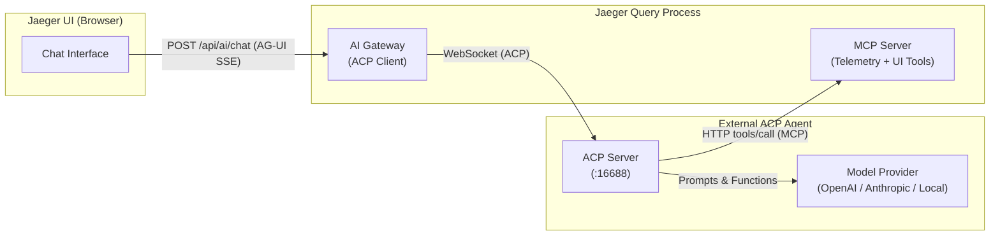

# Jaeger AI Agent Integration Contract

Jaeger's AI assistant uses a **Bring Your Own Agent (BYOA)** architecture. The Jaeger Query process does not bundle language models or agent execution engines. Instead, it acts as a client speaking the [Agent Client Protocol (ACP)](https://agentclientprotocol.com/) over WebSocket to an external agent process.



For a turnkey, zero-code worked example using an off-the-shelf native ACP agent, see **[Goose (ACP Agent)](./goose/README.md)**.

This document specifies the protocol contract for integrating or building an ACP agent for Jaeger.

---

## 1. Gateway Configuration

Configure the agent connection in Jaeger Query extension configuration:

```yaml
extensions:
  jaeger_query:
    ai:
      agent_url: "ws://127.0.0.1:16688/acp"
      agent_headers:
        Authorization: "Bearer ${env:AGENT_TOKEN}"
      # Enables the telemetry MCP server endpoint and turn-scoped UI tool dispatch:
      mcp: {}
      # Optional: health check interval (default 5s)
      # health_check_interval: 5s
```

* `agent_url`: The WebSocket URL of the ACP agent.
* `agent_headers`: Key-value map of HTTP headers sent during the WebSocket upgrade handshake. Header values are `configopaque` strings, protected from config dumps and logs.
* `mcp`: Enabling `mcp: {}` allows Jaeger to host its Model Context Protocol (MCP) server, exposing trace and service queries as tools.

---

## 2. Transport & Framing

* **Transport**: Standard WebSocket (`ws://` or `wss://`).
* **Message Framing**: Standard ACP JSON-RPC 2.0 messages sent across WebSocket text frames. Each frame contains a single JSON-RPC request, response, or notification.
* **Authentication**: Sent on HTTP upgrade request headers as configured in `agent_headers` (e.g., `Authorization: Bearer <token>` or `X-Secret-Key: <key>`).

---

## 3. Health Checks & UI Capabilities

The gateway regularly monitors agent liveness:

1. **Probe Connection**: Every `health_check_interval` (default 5s), the gateway opens a fresh WebSocket connection to `agent_url` with configured headers.
2. **Handshake**: It sends an ACP `initialize` request with client metadata:
   ```json
   {
     "jsonrpc": "2.0",
     "id": 1,
     "method": "initialize",
     "params": {
       "protocolVersion": 1,
       "clientCapabilities": { "fs": { "readTextFile": false, "writeTextFile": false }, "terminal": false },
       "clientInfo": { "name": "jaeger-ai-check", "version": "<git-version>" }
     }
   }
   ```
3. **Outcome**: If the agent responds with a valid `InitializeResponse`, the agent is healthy and the connection closes cleanly.
4. **UI Adaptation**: When healthy, the gateway advertises `"aiAssistant": true` in `/api/v3/capabilities`. The Jaeger UI automatically displays the AI assistant panel. If the agent is unreachable or fails the check, the panel is hidden.

---

## 4. Turn Lifecycle

Each chat message submitted to `/api/ai/chat` initiates an ACP turn:

### Phase 1: Initialize

The gateway dials `agent_url` and sends `initialize`:

```json
{
  "jsonrpc": "2.0",
  "id": 1,
  "method": "initialize",
  "params": {
    "protocolVersion": 1,
    "clientCapabilities": { "fs": { "readTextFile": false, "writeTextFile": false }, "terminal": false },
    "clientInfo": { "name": "jaeger-ai-gateway", "version": "<git-version>" }
  }
}
```

The agent must return an `InitializeResponse`:
* `agentInfo`: Name and version (e.g. `{"name": "goose", "version": "1.0.0"}`). Jaeger attaches these to OpenTelemetry spans.
* `agentCapabilities.mcpCapabilities.http`: Set to `true` if the agent supports receiving dynamic HTTP MCP servers via `session/new`.

### Phase 2: Session Creation (`session/new`)

The gateway calls `session/new`:

```json
{
  "jsonrpc": "2.0",
  "id": 2,
  "method": "session/new",
  "params": {
    "cwd": "/",
    "mcpServers": [
      {
        "type": "http",
        "name": "jaeger",
        "url": "http://127.0.0.1:16686/api/ai/mcp/<turn-route-id>/"
      }
    ]
  }
}
```

* **Session ID**: The agent generates a unique session ID returned in `NewSessionResponse`.
* **Turn-Scoped MCP Server**: When the agent advertises `mcpCapabilities.http`, the gateway announces its turn-scoped MCP endpoint in `mcpServers`. This endpoint serves:
  1. Jaeger telemetry tools (e.g., `get_services`, `get_operations`, `find_traces`, `get_trace`).
  2. Contextual UI tools supplied by the frontend for this turn (e.g., `show_flamegraph`, `set_filter`).

### Phase 3: Prompting & Tool Execution (`session/prompt`)

The gateway calls `session/prompt` with the user query and context blocks:

```json
{
  "jsonrpc": "2.0",
  "id": 3,
  "method": "session/prompt",
  "params": {
    "sessionId": "<session-id>",
    "prompt": [
      { "type": "text", "text": "What services have high error rates?" }
    ],
    "_meta": {
      "traceparent": "00-4bf92f3577b34da6a3ce929d0e0e4736-00f067aa0ba902b7-01"
    }
  }
}
```

#### Tool Calling & Routing
* **Telemetry Queries**: The agent executes tools against the announced `jaeger` HTTP MCP server (`tools/call`).
* **Contextual UI Actions**: Frontend-provided UI tools are also registered on the turn-scoped MCP server. When the model invokes a UI tool:
  - The gateway immediately relays a `TOOL_CALL_*` SSE event to the browser.
  - The tool execution returns an immediate `{acknowledged: true}` response so the agentic loop can continue without waiting for UI interaction.
* **Legacy ACP Extension Method**: For agents that do not support dynamic HTTP MCP servers, contextual tools are also passed in `session/new` under `_meta["jaegertracing.io/contextual-tools"]` prefixed with `ui_`. Agents dispatch these via the `_meta/jaegertracing.io/tools/call` extension method.

#### Progress Streaming
While executing, the agent sends `session/update` notifications over WebSocket:
* `AgentMessageChunk` -> translated to AG-UI `TEXT_MESSAGE_CONTENT` SSE events.
* `ToolCall` / `ToolCallUpdate` -> translated to AG-UI `TOOL_CALL_START`, `TOOL_CALL_ARGS`, `TOOL_CALL_RESULT`, `TOOL_CALL_END` SSE events.

#### Permission Requests
If the agent requests confirmation via `session/request_permission`, the gateway automatically approves `allow_once` or `allow_always` for curated tools.

### Phase 4: Completion & Cleanup

When the agent finishes its response, it returns `PromptResponse`:

```json
{
  "jsonrpc": "2.0",
  "id": 3,
  "result": {
    "stopReason": "end_turn"
  }
}
```

The gateway emits `TEXT_MESSAGE_END` and `RUN_FINISHED` to the browser, closes the session, and cleans up turn resources.

---

## 5. Tracing & OpenTelemetry Semantic Conventions

The gateway instruments AI assistant requests with OpenTelemetry tracing:

1. **Trace Propagation**: Active span context is injected into `session/prompt`'s `_meta` field using standard W3C TraceContext (`traceparent`, `tracestate`). Agents extracting these headers can parent their own internal spans under Jaeger's HTTP server span.
2. **Semantic Attributes**: The gateway attaches OpenTelemetry GenAI semantic convention attributes to the server span:
   - `gen_ai.operation.name`: `"invoke_agent"`
   - `gen_ai.agent.name`: Set from `InitializeResponse.agentInfo.name`
   - `gen_ai.agent.version`: Set from `InitializeResponse.agentInfo.version`
   - `gen_ai.conversation.id`: Set from `SessionId`

---

## 6. Verifying Your Agent

### 1. Start Jaeger with AI Enabled

Create a minimal configuration `config.yaml`:

```yaml
extensions:
  jaeger_query:
    ai:
      agent_url: "ws://127.0.0.1:16688/acp"
      mcp: {}
```

Start Jaeger:

```bash
go run ./cmd/jaeger --config config.yaml
```

### 2. Verify Health Check & UI

Ensure your agent is listening on `127.0.0.1:16688`. Query the Jaeger capabilities endpoint:

```bash
curl -s http://127.0.0.1:16686/api/v3/capabilities | jq .aiAssistant
```

The output should be `true`.

### 3. Send a Chat Request

Submit a chat prompt to the gateway:

```bash
curl -N -X POST http://127.0.0.1:16686/api/ai/chat \
  -H "Content-Type: application/json" \
  -d '{
    "threadId": "t1",
    "runId": "r1",
    "messages": [{"role": "user", "content": "What services are running?"}],
    "tools": []
  }'
```

You should receive an AG-UI Server-Sent Events (SSE) stream starting with `event: RUN_STARTED` and containing text message and tool call chunks.
